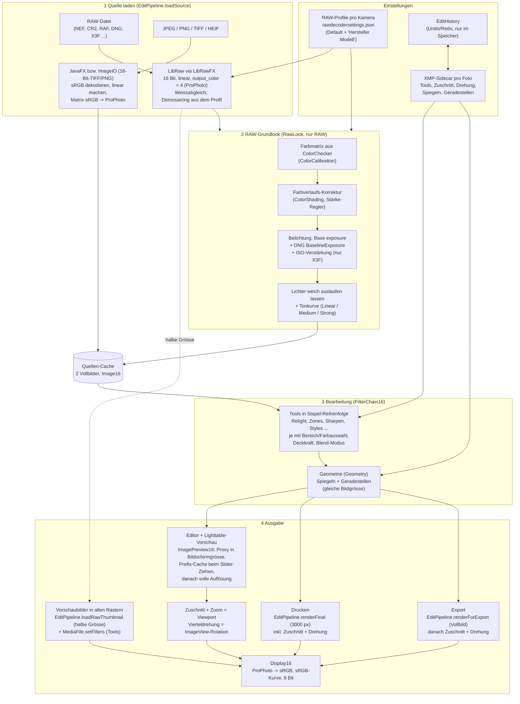

# Bild-Workflow in PhotoSlide

Alle Ansichten, die ein Foto zeigen oder ausgeben (Editor, Lighttable, Vorschaubilder, Drucken, Export), laufen über **eine** Pipeline in `org.photoslide.imageops.EditPipeline`. Gerechnet wird durchgehend mit **16 Bit linear im Arbeitsfarbraum ProPhoto (ROMM)**. Erst ganz am Ende wird nach sRGB 8 Bit umgerechnet.

## Übersicht

## Die Schritte im Einzelnen

### 1. Quelle laden

| Dateityp | Weg | Ergebnis |
|---|---|---|
| RAW | `LibrawImage.readPixelData16(bytes, true, OutputColor.PROPHOTO)`; LibRawFX setzt `gamm = 1`, `no_auto_bright = 1`, `output_color = 4` | linear, ProPhoto, 16 Bit |
| 16-Bit-TIFF/PNG | `AwtImage16.read16` | sRGB → linear → ProPhoto |
| JPEG, 8-Bit-PNG/TIFF, HEIF | JavaFX `Image` → `FxImage16.fromImage` | sRGB → linear → ProPhoto |

Die sRGB→ProPhoto-Matrix in `WorkingSpace` ist dieselbe, die LibRaw für `output_color = 4` verwendet. RAW- und JPEG-Dateien passen dadurch exakt zusammen; ein JPEG kommt ohne Bearbeitung unverändert wieder heraus.

Die Einstellungen des Dekoders kommen aus dem RAW-Profil der Kamera (`"Hersteller Modell"`, sonst `Default`). Sie werden im Dialog „RAW-Einstellungen“ gepflegt und von `RawSettingsStore` geladen.

### 2. RAW-Grundlook (`RawLook`)

Nur für RAW-Dateien, einmal direkt nach dem Dekodieren, in dieser Reihenfolge:

1. **Farbmatrix**: kameraspezifische 3×3-Matrix aus einem ColorChecker-Foto (`ColorCalibration`). Sie lässt Weiss weiss und ändert die Helligkeit nicht; der Weissabgleich bleibt Sache der Kamera bzw. von Auto-WB.
2. **Farbverlaufs-Korrektur** (`ColorShading`): Raster 24×16 mit Farbkorrekturen zu den Bildrändern. Sie wird aus den eingebetteten Kamera-JPEGs berechnet (`X3fPreview`) und hat einen Stärke-Regler.
3. **Belichtung**: Base exposure des Profils (Default +0,8 Blenden) plus `BaselineExposure` aus DNG-Dateien plus, nur bei X3F, die ISO-Verstärkung log₂(ISO/100). LibRaw lässt die Foveon-ISO-Verstärkung weg.
4. **Tonkurve**: Lichter laufen weich aus statt zu clippen, danach eine S-Kurve (Linear / Medium / Strong).

Das Ergebnis landet im **Quellen-Cache** (`EditPipeline.loadSource`, 2 Vollbilder). Wird ein RAW-Profil gespeichert, wird der Cache geleert.

### 3. Bearbeitung

- **Tools** (`AbstractImageFilter` → `Filter16`) in der Reihenfolge des Stapels. Jedes Tool kann auf einen Bereich (`Region`) oder eine Farbauswahl (`ColorSelection`) begrenzt sein und wird mit Deckkraft und Blend-Modus eingemischt (`BlendedFilter16`).
- **Styles** fügen fertige Tool-Stapel hinzu (`Styles`, aus LightZone).
- **Geometrie** (`Geometry`): Spiegeln und Geradestellen, ohne die Bildgrösse zu ändern. Deshalb bleiben Zuschnitt-Koordinaten gültig.
- Gespeichert wird alles im **XMP-Sidecar** neben dem Foto. Jede Änderung ist ein Schritt in der `EditHistory`; Undo, Redo und ein Klick in der History stellen einen Schritt wieder her.

Die Rechenschritte mit Potenzen (Relight, Sharpen, Contrast Mask) nutzen, wenn verfügbar, die Vector API (`imageops/simd`).

### 4. Ausgabe

| Ziel | Einstieg | Zuschnitt / Vierteldrehung |
|---|---|---|
| Editor | `ImagePreview16` | Viewport bzw. ImageView-Rotation (`ViewTools`) |
| Lighttable (grosse Vorschau) | `ImagePreview16` | Viewport bzw. ImageView-Rotation |
| Vorschaubilder (Lighttable, Stapel, Editor-Raster, Lesezeichen, Suche, Editor-Panel) | `MediaFileLoader` → `EditPipeline.loadRawThumbnail`, Tools über `MediaFile.setFilters` | Viewport und Rotation der Rasterzelle |
| Drucken | `EditPipeline.renderFinal` | im Bild enthalten |
| Export | `EditPipeline.renderForExport` | danach in `MainViewController` |

Am Ende rechnet `Display16` von ProPhoto nach sRGB um, wendet die sRGB-Kurve an und reduziert auf 8 Bit, bei Bedarf mit Dithering.

`ImagePreview16` rendert beim Bearbeiten zuerst einen **Proxy in Bildschirmgrösse**. Der **Prefix-Cache** (`PrefixCachedRenderer`) rechnet beim Ziehen eines Reglers nur das geänderte Tool und die darüberliegenden neu. 250 ms nach der letzten Änderung folgt die volle Auflösung.

## Wo welche Daten liegen

| Daten | Ort |
|---|---|
| RAW-Profile (Dekoder, Look, Farbmatrix, Farbverlauf) | `~/Library/Application Support/PhotoSlide/rawdecodersettings.json` |
| Bearbeitung eines Fotos | XMP-Sidecar `<Name>.xmp` neben dem Foto |
| Edit-History | nur im Speicher, solange die App läuft |
| Referenzfarben ColorChecker | im Code, `ColorCalibration` (X-Rite, 2014) |
